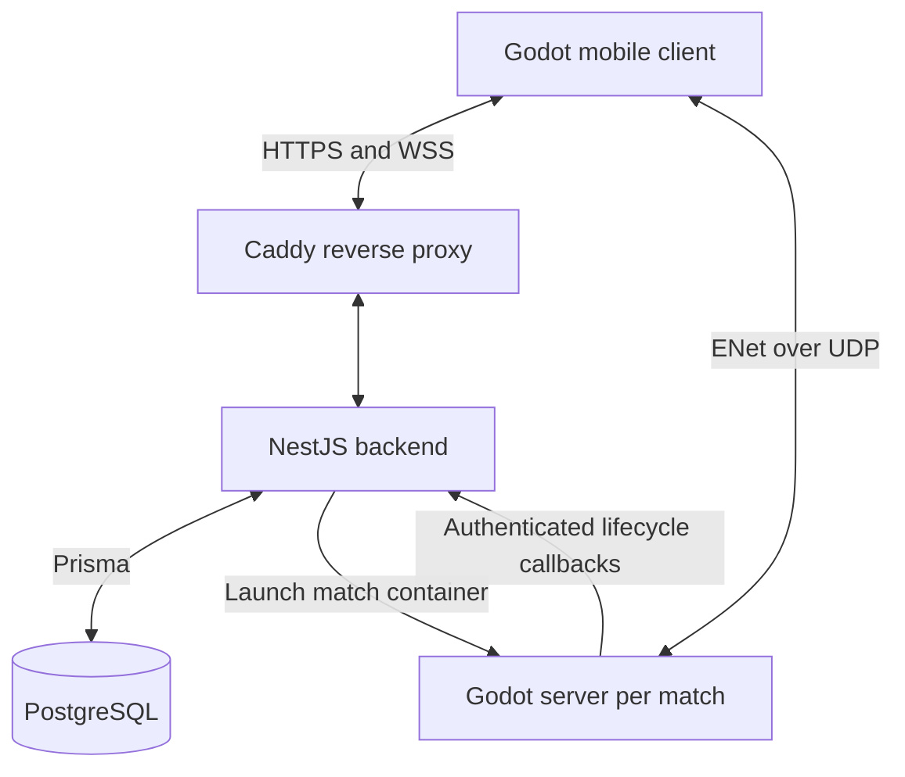
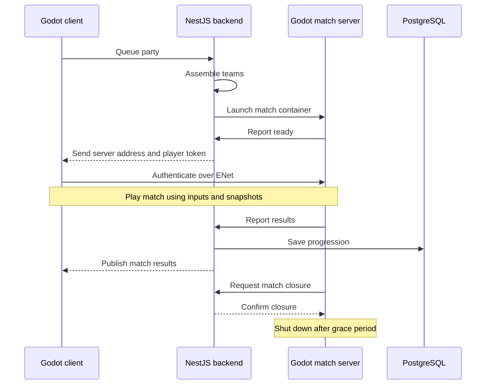
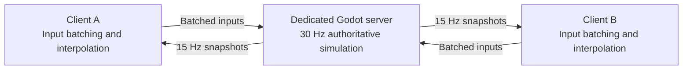

# Wompout

Wompout is an online multiplayer platform fighter for iOS and Android where players combine weapons, armour, and abilities to create their own loadouts and compete across a variety of game modes. Built with Godot and a TypeScript/NestJS backend, the game features authoritative dedicated servers, real-time matchmaking and social systems, and persistent player progression.

<p>
  <a href="https://apps.apple.com/app/smash-dash/id6769724763">App Store</a>
  &nbsp;|&nbsp;
  <a href="https://play.google.com/store/apps/details?id=com.felixjahr.smashdash">Google Play</a>
  &nbsp;|&nbsp;
  <a href="https://wompout.com">Website</a>
</p>

## Gameplay

- **Platform fighter combat** built around movement, positioning, knockback, melee and ranged attacks, and active abilities.
- **Multiple game modes** including ranked Solo Womp (1v1), Duo Womp (2v2), Super Womp (four-player free-for-all), Womp Draft (draft your loadout), and unranked matches.
- **Custom loadouts** combining melee weapons, ranged weapons, armour, and abilities such as dashing, double jumping, invisibility, and slam attacks.
- **Parties and social play** with friends, invitations, lobbies, party-based matchmaking, and bots filling remaining matchmaking slots when necessary.
- **Persistent progression** through ranked trophies, leaderboards, equipment unlocks, reward chests, character customization, and an in-game economy.

## Technical Highlights

- **Godot 4.7 game client** with reusable scenes for players, maps, equipment, menus, touch controls, and gameplay state.
- **Authoritative game server** that owns movement, damage, elimination, and match results. Clients submit player inputs over ENet, while the server validates match tokens and incoming packets.
- **Snapshot networking** with a 30 Hz server simulation, 15 Hz snapshots, client interpolation, and server-clock correction. Custom binary input packets use eight bytes per input, bit-packed action flags, quantized aim, and retransmission of recent inputs.
- **NestJS backend** for guest and email accounts, JWT access tokens, rotating refresh sessions stored as hashes, account linking, and account deletion.
- **WebSocket state coordination** with authenticated subscriptions, initial state snapshots, and subsequent updates for lobbies, invitations, friends, rankings, and matches.
- **Party-aware matchmaking** using backtracking to assemble teams without splitting parties. Each match gets a dedicated Docker container, assigned UDP port, connection credentials, and lifecycle monitoring.
- **PostgreSQL persistence through Prisma** for accounts, friendships, inventory, loadouts, currencies, and chest progression. Shop purchases and chest rewards use transactions; loadout changes validate item ownership.
- **Bot navigation and combat** using cached map geometry and traversal graphs to plan movement, select targets, switch weapons, and activate abilities through the same input structure as human players.
- **Docker deployment setup** for the backend, PostgreSQL, headless Godot servers, and a Caddy HTTPS reverse proxy.

## Tech Stack

| Area | Technology |
| --- | --- |
| Game engine | Godot 4.7, GDScript |
| Multiplayer gameplay | ENet, RPCs, authoritative simulation, binary packets |
| Backend API | NestJS, TypeScript, Node.js |
| Realtime coordination | WebSockets, RxJS |
| Database | PostgreSQL |
| ORM | Prisma |
| Email delivery | Resend |
| Deployment | Docker, Docker Compose, Caddy |

## Architecture

### System Overview

The mobile client connects to NestJS for accounts, parties, and progression, and directly to a dedicated Godot server for gameplay. The backend launches one server container per match. PostgreSQL stores persistent player data, while the backend manages temporary lobby, matchmaking, and match state in memory.



### Match Lifecycle

The backend assembles teams, starts a server, and sends connection details when it is ready. After play, the server reports results before requesting match closure and shutting down.



### Gameplay Networking

The server runs the authoritative simulation at 30 Hz and sends snapshots at 15 Hz. Clients send batched inputs and interpolate received snapshots for display. Input batches resend up to three recent inputs to tolerate packet loss. Gameplay uses ENet over UDP, with unreliable snapshots and reliable initialization and phase changes.



## Repository Structure

```text
.
+-- backend/              # NestJS API, authentication, matchmaking, social features
|   +-- src/              # Services, controllers, WebSocket gateway, tests
|   +-- prisma/           # PostgreSQL schema
|   +-- Dockerfile        # Backend build and runtime image
+-- godot/                # Godot project, client, dedicated server, game assets
|   +-- client/           # Client state machine and backend/game connections
|   +-- server/           # Dedicated server controller and networking
|   +-- data/             # Game modes, maps, weapons, armour, abilities, styles
|   +-- participant/      # Player simulation, presentation, and bot behavior
|   +-- packets/          # Binary input, snapshot, and state sync packets
|   +-- ui/               # Authentication, menus, lobby, HUD, and results
|   +-- Dockerfile        # Headless Godot server export and runtime image
+-- docker-compose.yml    # Backend, database, game-server image, reverse proxy
+-- Caddyfile             # HTTPS and invitation-domain routing
```

## Code References

- **Gameplay networking** combines compact binary inputs in [input_batch.gd](godot/packets/input/input_batch.gd) with snapshot interpolation and clock correction in [logic_client.gd](godot/data/modes/logic_client.gd).
- **Party-aware matchmaking** in [matchmaking.service.ts](backend/src/matchmaking/matchmaking.service.ts) uses backtracking to fill teams without splitting parties, with bots filling open slots after a timeout.
- **Realtime subscriptions** in [realtime.service.ts](backend/src/realtime/realtime.service.ts) use typed snapshot providers and per-connection queues, retrying setup when state changes during loading.
- **Client–backend authentication** pairs shared token refresh and WebSocket reauthentication in [client_backend_net.gd](godot/client/client_backend_net.gd) with hashed refresh tokens and atomic rotation in [sessions.service.ts](backend/src/sessions/sessions.service.ts).
